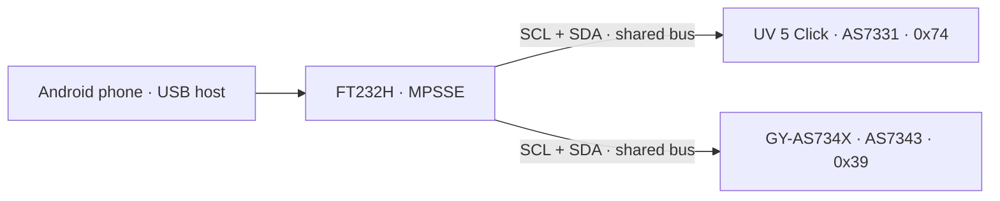

# Uvir

Android app and removable USB spectral-sensor prototype.

> **PROJECT SUSPENDED — OPTICAL CALIBRATION IS UNRESOLVED.**
> The app, USB communication and sensor readout work on the assembled prototype.
> **Reliable absolute irradiance measurements have not been achieved or validated.**
> Development has been suspended because resolving the optical design and calibration
> would require further equipment, experiments and expense beyond the available budget.

## Project on hold — optical design and calibration unfinished

Comparison trials with a commercial UV meter showed discrepancies. Changing only
the size or shape of the housing apertures did not provide a satisfactory solution.
Further work may require suitable diffusers or other optical components, angular
and spectral response characterization, and reference calibration. No particular
meter brand or model is required: a reference must suit the bands and measurement
being calibrated. These trials are observations, not a calibration certificate.

The source, app, connection plan and mechanical files remain available for anyone
who wants to study or continue the work. This is a functioning acquisition
prototype with unfinished metrology, **not a calibrated measuring instrument**.
See [what works, what remains and how to resume](docs/PROJECT_STATUS.md).

**The `main` branch develops Uvir for a measuring head connected through USB:
FT232H + UV 5 Click / AS7331 + GY-AS734X / AS7343.** The phone owns
sampling, processing, acquisition schedules, alerts, time and storage.
The measuring head has no ESP32, firmware, battery-backed clock or local archive.

## Download 0.1.1

[Download the signed Uvir APK](https://github.com/mondiversi/Uvir/releases/download/v0.1.1/Uvir-0.1.1.apk) ·
[Release notes and checksums](https://github.com/mondiversi/Uvir/releases/tag/v0.1.1) ·
[Wiring and first connection](docs/usb/WIRING.md)

This is a prerelease. Keep the original signing identity when updating, stop any
active session, and do not uninstall the app or clear its archive for testing.

## Preserved ESP32 project

The complete previous project is preserved on the
[legacy-esp32 branch](https://github.com/mondiversi/Uvir/tree/legacy-esp32),
at commit `7161a31711f249de2bc346199c269da7aaea88c5`.
Its preserved version is **1.4.2**, with firmware **0.5.119**.
Its source, firmware, PCB, printable parts, wireless
protocols and documentation remain recoverable.
The [archived README](docs/LEGACY_ESP32_README.md) describes that architecture.

The old ESP32 release pages and downloadable installers have been retired.
The ESP32 branch, source history and Git
tags remain intact, so that edition can still be rebuilt. The old ESP32 stable
update feed no longer has a published release. The Uvir APK is not an ESP32 update.

## New hardware

- Android phone with USB host/OTG and a USB data adapter/cable.
- FT232H MPSSE USB-to-I²C board (FT232R/FT232RL UART adapters cannot substitute).
- MIKROE UV 5 Click with AS7331, default I²C address `0x74`.
- Existing GY-AS734X breakout with AS7343, address `0x39`.

See the [wiring guide](docs/usb/WIRING.md) before connecting power.
The GY breakout's regulation/level shifting and the actual FT232H board's
3.3 V regulator must be checked; a bare AS7343 is a 1.8 V device.



The current build uses a **hand-built perfboard carrier**, with the optical
breakouts plugged into raised removable sockets rather than soldered directly
to the carrier. The [hardware guide](hardware/usb/README.md) documents functional
connections, without prescribing the prototype's individual wire-routing layout.

The [reference printable enclosure](hardware/printable/uvir-custom-case/README.md)
contains the corrected USB opening and a flat experimental lid with two **5 mm**
apertures. Source files and measured carrier/mounting/sensor positions are included.
These dimensions describe this prototype; the lid is not a validated optical head.

## Read the head without the app

The [standalone USB guide](docs/usb/STANDALONE.md) documents recognition,
conversion requests, returned register data and saturation checks for both
optical modules. It includes a [Python terminal reader](tools/examples/uvir_ft232h.py)
for individual or continuous **raw-count** readings. The external host must
implement any conversion, calibration, averaging and recording it needs.
This is USB/MPSSE/I²C, not the preserved ESP32 text/COM-port protocol.
The independent Python example is not yet validated on physical hardware.

## App behavior

- One attached USB measuring head, with a fixed localized name.
- General settings combine Theme with acquisition and alert notification options.
- One phone-settings JSON and one SQLite database export, without new passwords;
  older encrypted backups remain importable.
- Separate detection of the adapter and both optical chips.
- Missing, incomplete, timed-out or saturated readings do not become valid zeros.
- W/m² calculations and database values; display units and decimals remain presentation choices.
- Channel offsets, factors and independent optical-window master × channel multipliers
  are applied on the phone. The reference-measurement dialogs are retained.
- Manual acquisitions, manual groups, timed/conditional acquisition sessions and
  threshold alerts are phone-owned.
- Disconnecting USB stops ongoing sessions. Reconnection never silently resumes them.
- Existing acquisitions, sessions, alerts, notes and full-precision measurements remain readable.
  The phone archive removes sensor profiles, hardware IDs and external-trigger metadata;
  legacy sensor calibration is not automatically transferred to a new head.
- No wireless association, sensor naming, autonomous storage, RTC battery warnings,
  status LEDs/buzzer, external trigger or ESP32 firmware update in the new interface.
- Simulated readings/events remain available for testing. Live simulation starts off
  and is foreground-only; it cannot claim a real USB device or acquire a hardware wake lock.

[Architecture and migration](docs/usb/ARCHITECTURE.md) ·
[Validation checklist](docs/usb/VALIDATION.md)

## Optical limitations

The previous lid and light-entry tubes are **theoretical prototypes**, not a
validated measuring head. Narrow tubes reject oblique and diffuse light.
A constant software multiplier cannot restore an angle-dependent loss.
The final mechanical assembly, any protective window/diffuser and both optical
channels require comparison with suitable reference instruments.
See [current optical calibration status](docs/usb/CALIBRATION.md).
The old ESP32 PCB/enclosure design is not a finished PCB for the new USB head.

## Build

Open in Android Studio and use JDK 21 (the bundled JBR is suitable).
Uvir `0.1.1` is published as a development prerelease.
See [release building and signing](RELEASE.md).

```text
gradlew :app:testDebugUnitTest :app:assembleDebug -PuvirIsolatedVerification=true
```

The verification package is separate from the installed app and its archives.
Do not uninstall the real app to test migration. Signing keys remain private and
outside Git. Software and geometry checks do not establish optical calibration,
physical compatibility of every breakout variant, or operation on every Android device.

## License

See [LICENSE](LICENSE) and [third-party notices](third_party).
