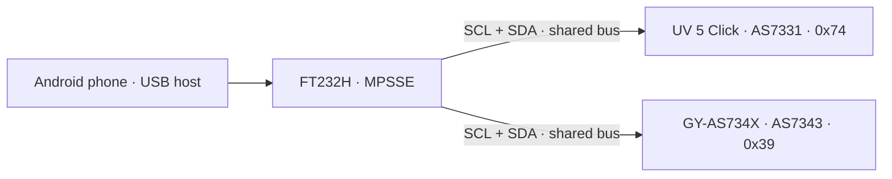

# Uvir — USB edition (in development)

Android app for spectral irradiance acquisition and estimated biological effects.

**The `main` branch is being redesigned for a USB-only measuring head:
FT232H + UV 5 Click / AS7331 + GY-AS734X / AS7343.** The phone owns
sampling, processing, acquisition schedules, alerts, time and storage.
The measuring head has no ESP32, firmware, battery-backed clock or local archive.

> **Hardware validation is pending.** The FT232H board has not arrived yet.
> Driver tests and an Android build do not prove electrical compatibility,
> sensor timing, screen-off reliability or measurement accuracy.
> Optical response and absolute calibration remain unvalidated.
> Do not use these provisional readings for exposure or safety decisions.

## Try the 0.1.0 preview

[Download the signed USB APK](https://github.com/mondiversi/Uvir/releases/download/v0.1.0/Uvir-0.1.0.apk) ·
[Release notes and checksums](https://github.com/mondiversi/Uvir/releases/tag/v0.1.0) ·
[Wiring and first connection](docs/usb/WIRING.md)

This is a prerelease. Keep the original signing identity when updating, stop any
active session, and do not uninstall the app or clear its archive for testing.

## Preserved ESP32 project

The complete previous project is preserved on the
[legacy-esp32 branch](https://github.com/mondiversi/Uvir/tree/legacy-esp32),
at commit `7161a31711f249de2bc346199c269da7aaea88c5`.
Its stable release is [**1.4.2**](https://github.com/mondiversi/Uvir/releases/tag/v1.4.2),
with firmware **0.5.119**. Its source, firmware, PCB, printable parts, wireless
protocols and documentation remain recoverable.
The [archived README](docs/LEGACY_ESP32_README.md) describes that architecture.

**The 1.4.2 APK and ESP32 firmware belong together.** This development branch
does not replace those public installers and must not be shipped to ESP32
users through the legacy automatic update channel.

## New hardware

- Android phone with USB host/OTG and a USB data adapter/cable.
- FT232H MPSSE USB-to-I²C board (FT232R/FT232RL UART adapters cannot substitute).
- MIKROE UV 5 Click with AS7331, default I²C address `0x74`.
- Existing GY-AS734X breakout with AS7343, address `0x39`.

See the [wiring guide](docs/usb/WIRING.md) before connecting power.
The GY breakout's regulation/level shifting and the actual FT232H board's
3.3 V regulator must be checked; a bare AS7343 is a 1.8 V device.



## App behavior

- One attached USB measuring head, with a fixed localized name.
- General settings combine Theme with acquisition and alert notification options.
- One phone-settings JSON and one SQLite database export, without new passwords;
  older encrypted backups remain importable.
- Separate detection of the adapter and both optical chips.
- Missing, incomplete, timed-out or saturated readings do not become valid zeros.
- W/m² calculations and database values; display units and decimals remain presentation choices.
- Channel offsets, factors and independent optical-window master × channel multipliers
  are applied on the phone. The reference-measurement dialogs are retained.
- Manual acquisitions, manual groups, timed/conditional acquisition sessions and
  threshold alerts are phone-owned.
- Disconnecting USB stops ongoing sessions. Reconnection never silently resumes them.
- Existing acquisitions, sessions, alerts, sensor identities and import/export formats
  remain readable. Legacy sensor calibration is not automatically transferred to a new head.
- No wireless association, sensor naming, autonomous storage, RTC battery warnings,
  status LEDs/buzzer, external trigger or ESP32 firmware update in the new interface.
- Simulated readings/events remain available for testing. Live simulation starts off
  and is foreground-only; it cannot claim a real USB device or acquire a hardware wake lock.

[Architecture and migration](docs/usb/ARCHITECTURE.md) ·
[Validation checklist](docs/usb/VALIDATION.md)

## Optical limitations

The previous lid and light-entry tubes are **theoretical prototypes**, not a
validated measuring head. Narrow tubes reject oblique and diffuse light.
A constant software multiplier cannot restore an angle-dependent loss.
The final mechanical assembly, any protective window/diffuser and both optical
channels require comparison with suitable reference instruments.
See [optical calibration](hardware/calibration/README.md).
The old ESP32 PCB/enclosure design is not a finished PCB for the new USB head.

## Build

Open in Android Studio and use JDK 21 (the bundled JBR is suitable).
The USB edition starts at `0.1.0` and is published as a development prerelease.
See [release building and signing](RELEASE.md).

```text
gradlew :app:testDebugUnitTest :app:assembleDebug -PuvirIsolatedVerification=true
```

The verification package is separate from the installed app and its archives.
Do not uninstall the real app to test migration. Signing keys remain private and
outside Git. No FT232H hardware test or optical calibration is claimed by this build.

## License

See [LICENSE](LICENSE) and [third-party notices](third_party).
