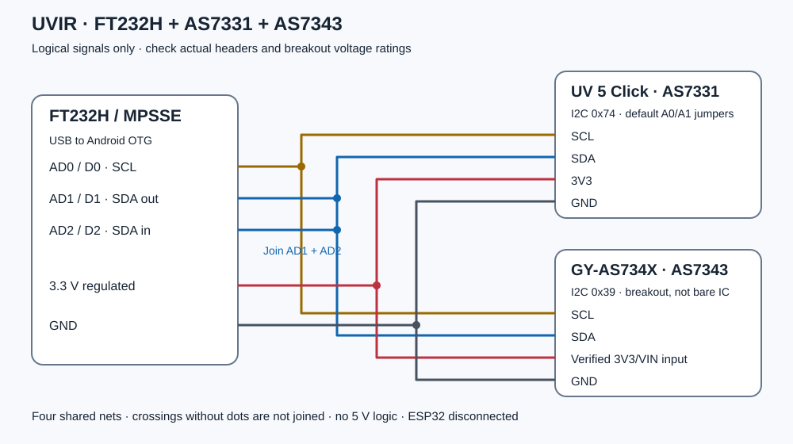

# Uvir functional wiring and first connection

The assembled prototype uses this shared-bus connection plan. The diagram is
not a physical header photograph or an individual perfboard wire-routing plan.
Check the actual breakout markings and power circuitry when replicating it.
Leave the old ESP32 disconnected from the bus. See the
[hardware and removable-module guide](../../hardware/usb/README.md).

The diagram shows **signal names, not the physical order of header pins**.

| FT232H signal | UV 5 Click | GY-AS734X / AS7343 breakout |
|---|---|---|
| AD0 / D0 (SCL) | SCL | SCL |
| AD1 / D1 **joined to AD2 / D2** (SDA) | SDA | SDA |
| Verified regulated 3.3 V rail | 3V3 | 3V3/VIN **only after confirming breakout input rating** |
| GND | GND | GND |

AD1 is the FT232H data output and AD2 its input: both must reach the same SDA
wire. There is one shared bus, with four common nets branching to both modules.
The UV board's SYN, RDY and Click-ID connection are not used. Do not wire a 5 V
pin to either sensor's logic. Do not join another controller's active I²C pins.

Connect the phone with a **USB-C male to USB-A female OTG data adapter** if the
chosen FT232H board has a USB-A plug. A charging-only cable will not work.

## Checks before applying power

1. Verify that it is FT232H (normally USB VID 0403, PID 6014), not FT232R/FT232RL.
2. Check the board's 3.3 V regulator and current budget; specifications for the
   Adafruit FT232H board do not certify an unrelated CJMCU board.
3. Confirm the GY-AS734X breakout accepts 3.3 V supply and has appropriate I/O
   level translation. The **bare AS7343 requires 1.8 V**, unlike this assumed
   breakout-level connection. If that circuitry is absent, use proper regulation
   and bidirectional I²C level translation instead of this direct hookup.
4. Check SDA/SCL idle levels, pull-ups and all common grounds. UV 5 Click already
   includes 2.2 kΩ pull-ups to 3.3 V; account for any parallel pull-ups on the GY
   board. Keep wires short. Initial bus clock is 100 kHz.
5. FT232H powers up in its EEPROM/default mode before Android switches it to
   MPSSE. Check that its startup pin states cannot contend with the sensor bus.

The driver uses FT232H drive-only-zero mode; SDA/SCL are released high through
pull-ups, not driven high by push-pull outputs. Clock stretching is not supported
by this initial driver; verify both modules work with the chosen timing.

## First connection and live readings

1. Install the signed [Uvir 0.1.1](https://github.com/mondiversi/Uvir/releases/tag/v0.1.1)
   on an Android 8.0+ phone with USB host/OTG support. An existing installation
   can be updated with the same signing identity; do not uninstall it to test.
2. With USB disconnected, wire the modules as above and inspect the supply,
   grounds, pull-ups and the **AD1–AD2 bridge**. Do not connect the old ESP32.
3. Attach the head to the phone through the OTG data adapter. Open Uvir and
   accept Android's permission to use the FT232H. No COM-port terminal, FTDI
   Android package or sensor firmware upload is required by this app.
4. The app initializes MPSSE and checks AS7331 at `0x74` and AS7343 at `0x39`.
   Both optical chips must initialize before the main view displays real values.
   Ensure simulated data is off when checking the physical hardware.
5. Open **Diagnostics > Sensor diagnostics** and use **Run diagnostics** after
   granting USB permission. The button also works when one or both optical
   modules failed to initialize. Its report lists FT232H USB/MPSSE/I²C checks,
   then AS7331 (`0x74`) and AS7343 (`0x39`) recognition, chip ID, initialization
   and reading results separately. A missing module cannot hide the other one.
   A failed idle connection gets one fresh initialization attempt. A healthy
   connection supplies six new reading pairs without reconnecting or interrupting
   sessions. Calibration and saved records are unchanged; failures enter the
   error log, and the report can be saved or shared. No RTC, FRAM, SD or ESP32
   firmware fields appear. The button is disabled without an authorized real
   FT232H, during initialization/reference collection and with simulated data.
6. Compare covered/uncovered readings without applying new calibration first.
   Live readings should update before starting manual acquisition, an automatic
   session or alert recording. Stop a session before unplugging the head.

| Symptom | Check first |
|---|---|
| No adapter detected | OTG/data cable, phone USB-host support, FT232H `0403:6014` identity |
| I2C lines held low / NACK | Power, grounds, AD1–AD2 bridge, SCL/SDA, pull-ups and address jumpers |
| AS7331 identity mismatch | UV 5 Click power/address; A0/A1 must match the default `0x74` |
| AS7343 identity mismatch | Exact GY chip model (`AS7343`, not AS7341), breakout power and `0x39` |
| Not ready / saturation | Light level and gain settling; failed readings are not saved as zeros |

The app uses Android's USB host API to drive MPSSE directly. There is **no
firmware to flash onto the FT232H**. The prototype has supplied real readings; compatibility of other boards and
startup pin behavior must still be checked. Absolute irradiance and optical
calibration remain unresolved. See [project status](../PROJECT_STATUS.md).

## Use a computer instead of Android

See [Read Uvir without the Android app](STANDALONE.md) for the terminal reader,
register send/receive sequences and the division between raw readings and
host-side calculations. No ESP32 serial commands or firmware are involved.

## Identity

FT232H USB serial numbers depend on its optional programmed EEPROM. An adapter
without a usable serial number does not acquire a globally unique identity from
its model or I²C addresses. The app uses a temporary attachment identity for
connection/reference/diagnostic tracking in memory when no serial is available.
It is not saved as record provenance. Sampling and calibration settings
belong to the phone and survive disconnect/reconnect independently of that
identity. No ESP32 hardware ID is fabricated.

## Primary references

- [FTDI FT232H datasheet](https://ftdichip.com/wp-content/uploads/2024/09/DS_FT232H.pdf)
- [FTDI MPSSE commands, AN_108](https://ftdichip.com/Support/Documents/AppNotes/AN_108_Command_Processor_for_MPSSE_and_MCU_Host_Bus_Emulation_Modes.pdf)
- [FTDI I²C example, AN_255](https://ftdichip.com/wp-content/uploads/2020/08/AN_255_USB-to-I2C-Example-using-the-FT232H-and-FT201X-devices-1.pdf)
- [MIKROE UV 5 Click schematic](https://download.mikroe.com/documents/add-on-boards/click/uv-5-click/UV_5_click_v100_Schematic.pdf)
- [ams OSRAM AS7343 datasheet](https://look.ams-osram.com/m/5f2d27fff9a874d2/original/AS7343-14-Channel-Multi-Spectral-Sensor.pdf)
