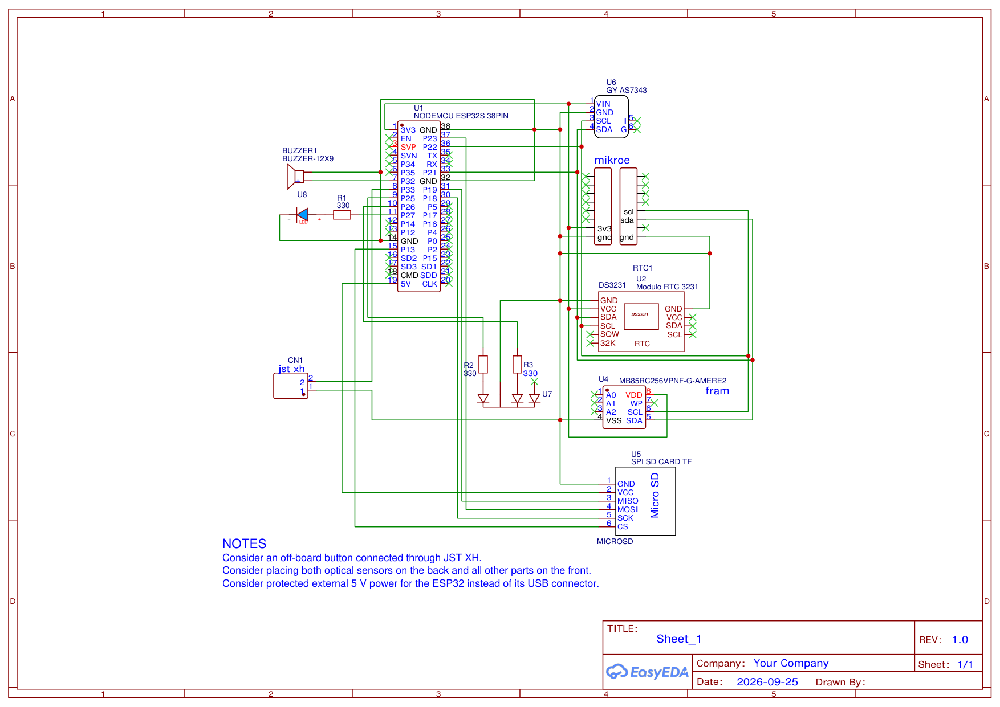
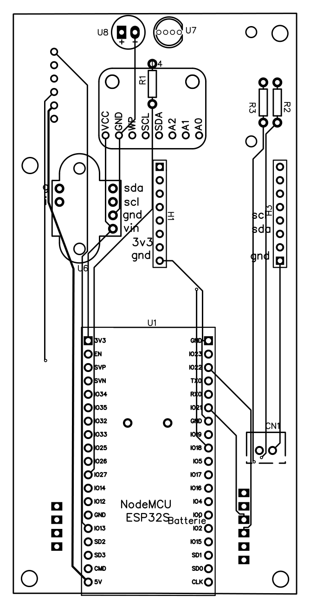
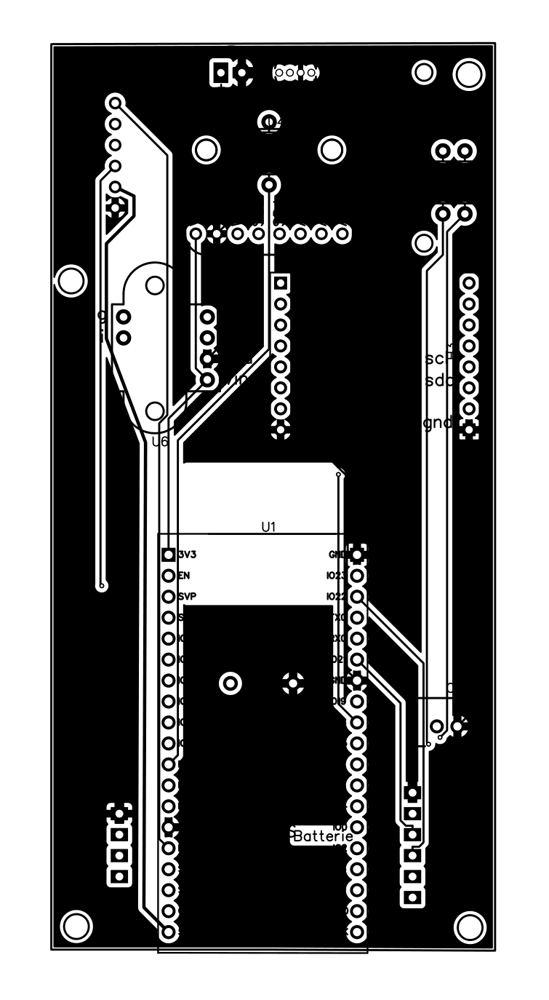

# UVIR carrier - design exports dated 2026-10-05

This collection contains an electrical schematic, two PCB-layout exports and
the supplied manufacturing archive. It was prepared on 2026-10-17 and is shared
as a development snapshot for review. **It is not a fabrication approval.**

Personal project names, drawing-author fields, personal library display names
and a personal silkscreen signature have been removed from the publication
copies. Original intake files are kept outside the repository. No circuit
redesign, routing change or calibration change was made during this cleanup.

## Files

| Purpose | Editable file | PDF preview |
|---|---|---|
| Electrical schematic | [EasyEDA Standard JSON](schematic/uvir-carrier-schematic.json) | [Schematic](schematic/uvir-carrier-schematic.pdf) |
| Layout export V3 | [EasyEDA Standard JSON](pcb/uvir-carrier-v3.json) | [Layout V3](pcb/uvir-carrier-v3.pdf) |
| Layout export V4, copper fill | [EasyEDA Standard JSON](pcb/uvir-carrier-v4-copper.json) | [Layout V4](pcb/uvir-carrier-v4-copper.pdf) |
| Manufacturing export for V4 | [Gerber and drill ZIP](manufacturing/uvir-carrier-v4-copper-gerbers.zip) | Not a print-scale drawing |
| Earlier logical design | [R1 reference files](reference/README.md) | Schematic reference only |

The V3 and V4 labels distinguish the supplied exports; they do not indicate
three or four copper layers. The supplied Gerber archive contains top and
bottom copper files and no inner-copper files. V4 adds a copper area and
additional silkscreen text compared with V3. Both layouts are retained;
neither has been silently substituted for the other.

The PDF exports are visual references, not production tooling or verified
1:1 assembly templates. Some source-library labels and part identifiers are
retained verbatim to avoid changing component identity or footprint geometry.
The schematic's design-review notes have been translated into English.

## Open in EasyEDA Standard

Use **File > Open > EasyEDA...** and select a schematic or PCB JSON from the
table above. The schematic file is a project/sheet export; the PCB files are
native board documents. The pin-netlist in `reference/` is a logical wiring
reference, not an importable PCB document.

Do not regenerate the new physical layouts using the older R1 schematic
generator. These are different design artifacts and need to be reviewed
together before selecting a release revision.

## Quick visual references

### Electrical schematic

### Layout V3

### Layout V4, copper fill

## Review and publication

Read [REVIEW.md](REVIEW.md) before building or publishing this collection.
[manifest.json](manifest.json) records file hashes and the checks performed
during preparation. It contains only the anonymized publication paths.

Privacy cleanup and publication are not an electrical, mechanical, optical or
licensing certification. In particular, community-library reuse/attribution terms,
physical sockets, the outline and firmware/net compatibility still require
review before the final hardware release.
