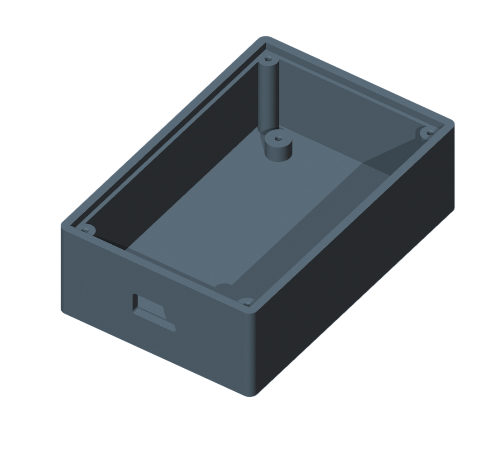
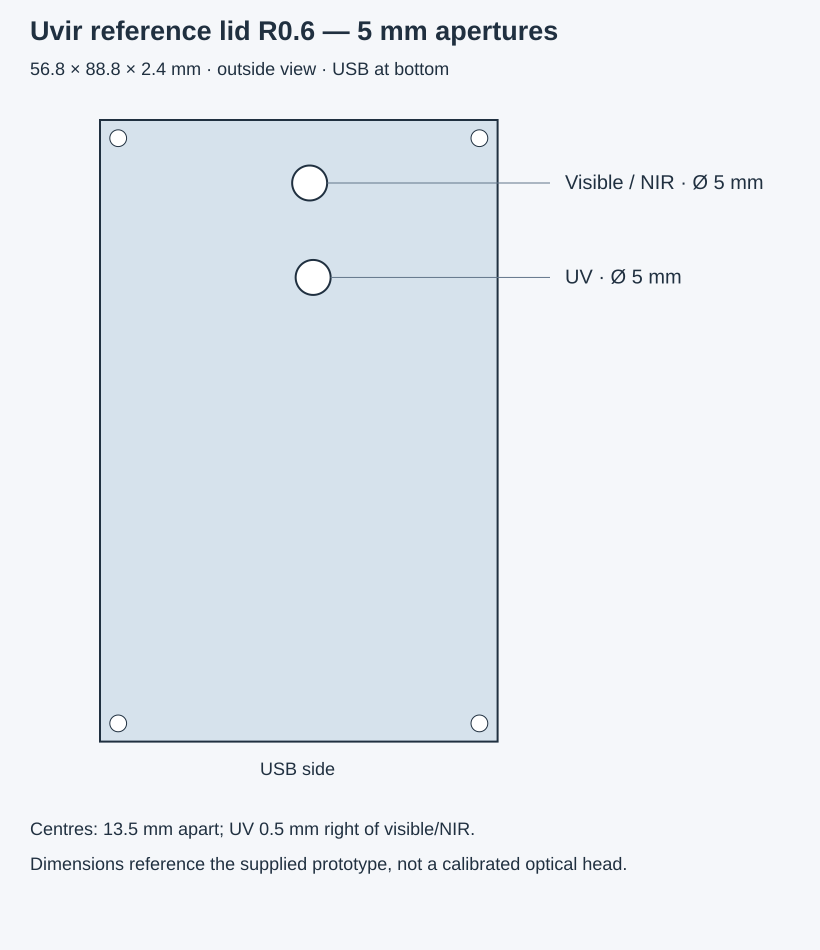

# Uvir reference case and experimental 5 mm lid

The published pair is **lower case R0.3** with the corrected USB opening and
**flat lid R0.6** with two **5 mm diameter** apertures. These are original
prototype parts for the current FT232H assembly.
Optical calibration remains unresolved; the lid is a test variant.




## Files and printing

- [Lower case STL](uvir-custom-case-base-r03.stl).
- [5 mm lid STL](uvir-custom-case-lid-r06-5mm.stl).
- [Editable lid OpenSCAD source](uvir-custom-case-lid-r06-5mm.scad).
- [Case generator](build_case.py), [lid generator](build_lid.py), and
  [independent STL checks](verify_stl.py), with their input JSON files.
- [Reference and checksums](reference.json).

STL coordinates are **millimetres**. Import at **100% scale**, check the
dimensions in the slicer, and generate toolpaths for the actual printer/material.
The flat bottom of each part goes on the bed. Inspect the bridge above the USB
opening. At 0.2 mm layer height the 2.4 mm lid has 12 layers. No machine-specific
G-code is supplied. Check fit and light-tightness; print tolerances depend on
the printer. The approximately 2 mm self-tapping screw assumption remains a
prototype assumption, not a specification for every screw.

## Case and height stack

| Item | Dimension |
|---|---:|
| Case exterior, width × length × height | 62 × 94 × 28.8 mm |
| Wall / floor thickness | 2.4 / 2.4 mm |
| Exterior plan corner radius | 2.4 mm |
| PCB supports above inside floor | 5 mm |
| PCB underside from outside bottom | 7.4 mm |
| Maximum assembly height including carrier | Approximately 18 mm |
| Lid underside from outside bottom | 26.4 mm |
| Gap above highest component | Approximately 1 mm |
| Estimated sensor-window plane to lid underside | Approximately 2 mm |
| Lid, width × length × thickness | 56.8 × 88.8 × 2.4 mm |
| Lid side clearance / support ledge | 0.2 / 1.2 mm |

The lid and its recess have square corners; only the case exterior is rounded.
The lid has four plain 2.4 mm screw-clearance holes, without screw-head recesses.
The base has 1.6 mm blind pilot holes: depth 4 mm for the carrier supports and
6 mm for lid posts. Choose screw lengths that do not break through the floor.

## USB opening correction

The previous printed opening was filed only upwards until its total height was
13 mm. Its lowest 6 mm was then reported as unused space. Keeping the original
lower datum at 5 mm from the **outside** bottom gives this corrected opening:

| Item | Dimension |
|---|---:|
| Opening width × height | 14.1 × 7 mm |
| Lower edge from outside bottom | 11 mm |
| Upper edge from outside bottom | 18 mm |
| Opening corner radius | 1 mm |
| USB protrusion from carrier edge | Approximately 15 mm |
| Covered / exposed protrusion | Approximately 3 / 12 mm |

The connector centre is 0.5 mm right of the carrier centre. The carrier is offset
0.5 mm left in the case so the USB is centred on the enclosure. The opening
correction changes neither carrier supports nor the lid seat. These are the
user-specified opening dimensions derived from a fit adjustment, not a separate
precision measurement of every connector surface. No additional height allowance
was silently added. A fresh physical fit of the revised STL is not claimed.

## Carrier and mounting coordinates

The perfboard is approximately **43.5 mm wide × 85.8 mm long × 1.5 mm thick**.
View the components from above with USB at the bottom. Carrier screw centres:

| Row / column | Centre distance from carrier edge |
|---|---:|
| Left column | 4.2 mm from left |
| Right column | 3.5 mm from right |
| Upper row | 6.5 mm from top |
| Lower row | 7.3 mm from bottom |

Supports have nominal diameter 7.2 mm. Lid posts are independent of carrier
fixings. Input and derived case coordinates are in [case parameters](case-parameters.json).
The optical breakouts are removable on raised plug-in sockets/supports; they
are not soldered directly to the carrier. The individual wire layout is not
prescribed by these mechanical coordinates.

## Latest sensor centres and lid holes

The origin below is the **top-left corner of the carrier**, components facing up,
USB down. X runs rightwards and Y downwards. Latest references supersede earlier
rough measurements:

| Sensor | X from carrier left | Y from carrier top |
|---|---:|---:|
| Visible/NIR | 23.8 mm, derived from UV X minus 0.5 mm | Approximately 6.4 mm |
| UV | 24.3 mm | Approximately 19.9 mm, derived from centre spacing |

The UV is **0.5 mm right** of visible/NIR; the **straight-line centre distance
is 13.5 mm**. Its resulting vertical separation is about 13.491 mm. See
[input measurements](sensor-measurements.json) and [lid parameters](lid-parameters.json).

Relative to the lid's top-left corner, visible/NIR is at approximately
**(29.95, 9.00) mm**, UV at **(30.45, 22.491) mm**. Both holes are straight Ø 5 mm
through the 2.4 mm plate; there are no projecting tubes or rims. Clear material
is 8.5 mm between apertures and 6.5 mm between the visible/NIR aperture edge and
the lid's top edge. These quoted gaps concern the printed lid, not the carrier.

Measurements were taken on the prototype and are approximate. A different
carrier, socket stack or module location requires checking these dimensions;
do not infer another assembly's USB height solely from its board size.

## Rebuild and verify

In this directory, with Python and the dependencies installed:

```sh
python -m pip install -r requirements.txt
python build_case.py
python build_lid.py
python verify_stl.py
```

Checks reopen the exported STL files and verify closed connected geometry,
dimensions, support heights, USB opening and lid clearance. They do not establish
physical print fit or radiometric accuracy. The [project repository](https://github.com/mondiversi/Uvir)
contains wiring, calibration limitations and application source.
