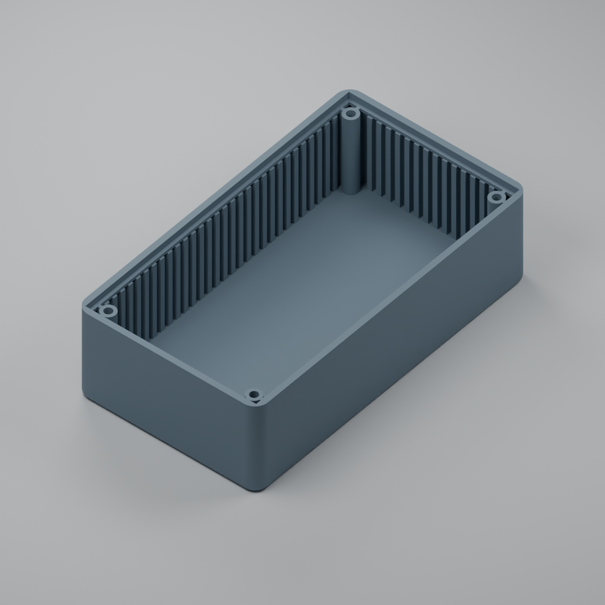

# Printable enclosure body R1

This is an **independent printable reconstruction** for the UVIR prototype,
using the main dimensions of the **TEKO COFFER-A/6.5** housing. It is not an
official TEKO CAD model or a reproduction of every moulded detail. It provides
the **body only, with a closed floor and an open top**; no lid is included.

The references are the [manufacturer's product page](https://www.teko.it/en/products/family/TC/series/coffer-a)
and [COFFER-A/6 technical drawing](https://www.teko.it/uploads/manuali/pdf/COFFER-A_6.pdf).
The manufacturer PDF/DWG are linked as references rather than redistributed.

## Files

- [Printable STL](uvir-enclosure-body-r1.stl): import at **1:1 scale in millimetres**
  into the printer's slicer. It contains one connected solid and no lid.
- [Editable OpenSCAD source](uvir-enclosure-body-r1.scad): dimensions, guide ribs,
  lid support and pilot holes can be adjusted.
- [Dimensions, sources and lid-fit report](geometry-and-dimensions.json): separates
  published dimensions from reconstructed print features.
- [STL geometry verification](stl-verification.json): connectivity, orientation,
  dimensions, volume and file hash.
- [Exported-surface checks](surface-checks.json): floor, walls, support height,
  guide height and blind-hole checks on the actual STL.

## Main dimensions

The model uses X for width, Y for length and Z for height. Its bottom-left
outside corner is the XY origin. Nominal dimensions are in millimetres.

| Feature | Value |
|---|---:|
| Outside width x length x height | 70 x 125 x 35 |
| Straight-wall thickness | 2.2 |
| Floor thickness | 2.2 |
| Plan-view outside corner radius | 5 |
| Outside bottom-edge radius | 2 |
| Nominal top opening / panel reference footprint | 65.6 x 120.6 |
| Lid seat below the top rim | 2.5 |
| Floor to lid underside | 30.3 |
| Floor to guide top | 29.2 |
| Fixing-center spacing, X x Y | 56 x 111 |
| Screw-post outside diameter | 5.5 |
| Pilot-hole diameter | 3 |

The fixing centers are `(7, 7)`, `(63, 7)`, `(7, 118)` and `(63, 118)`.
The nominal 65.6 x 120.6 opening is consistent with the panel reference and
the outside size minus two 2.2 mm walls. Ribs and corner supports occupy part
of the space below the lid; these dimensions are not a rectangular PCB envelope.

## Reconstructed details for printing

The drawing does not fully dimension the moulded guide profiles, web shapes,
hole depths, draft or all mounting details. This print version uses:

- a continuous 1.2 mm wide/thick support ledge at **Z = 32.5 mm**;
- 1.2 mm webs connecting the four posts to the walls;
- **12 mm deep blind** pilot holes, leaving the floor intact;
- guide ribs projecting 1.8 mm, with 1.8 mm width/gaps, 3.6 mm pitch and
  symmetric placement, ending at **Z = 31.4 mm**.

These are editable reconstruction choices, not a claim that the OEM mould is
identical. The ledge is an added continuous support for the printed replacement
lid. The source can disable the guides with `guides_enabled = false`. Mould
draft, ejection marks and surface texture are not reproduced. No USB, microSD,
button, buzzer or LED cutouts have been added to the blank body.

## Fit with the existing optical lid

Use the separate [replacement optical lid R1](../uvir-optical-lid-r1/README.md),
which remains unchanged. Center its 65.4 x 120.3 mm plate on the 65.6 x 120.6 mm
opening, with its underside resting at **Z = 32.5 mm**. The lid's local origin
then translates to `(2.3, 2.35, 32.5)` in body coordinates.

The nominal clearance is **0.1 mm per side across the width** and **0.15 mm per
side along the length**. The 2.4 mm plate ends 0.1 mm below the body rim. The
exported models have no volumetric interference at this placement; this is a
geometric check, not a guarantee of printed fit. Printer shrinkage and extrusion
may require an adjusted clearance.

The existing lid has **no fixing holes or snap features**, so retention still
needs to be arranged. The body provides the four pilot posts; do not assume a
specific screw type or thread from the nominal 3 mm hole alone. The lid-relative
fixing centers, if adding matching holes later, are `(4.7, 4.65)`, `(60.7, 4.65)`,
`(4.7, 115.65)` and `(60.7, 115.65)`.

## Printing and validation

Print with the **flat bottom on the build plate and the opening upward**. Check
the slicer preview around the small lid-support overhang and the blind pilots.
Use a layer plan that preserves the 32.5 mm lid-seat height; 0.1 mm layers or a
local adaptive layer setting can represent that height exactly, whereas uniform
0.2 mm layers quantize it. Check actual line widths for the 1.2 mm webs/ledge.

The supplied STL passed closure, orientation, connectivity, dimensions and
open-top/floor checks. The assembled lid passed a mesh-interference check.
Physical fit, fastener retention, material opacity, PCB fit and final optical
calibration remain to be verified. A printed polymer body does not inherit
the material or performance specifications of the purchased TEKO enclosure.

Keep the [visible/NIR light shield](../uvir-visible-nir-shield-r1/README.md) and
final optics in the assembly. See [assembly guidance](../../ASSEMBLY.md) and
the [calibration plan](../../calibration/README.md).
