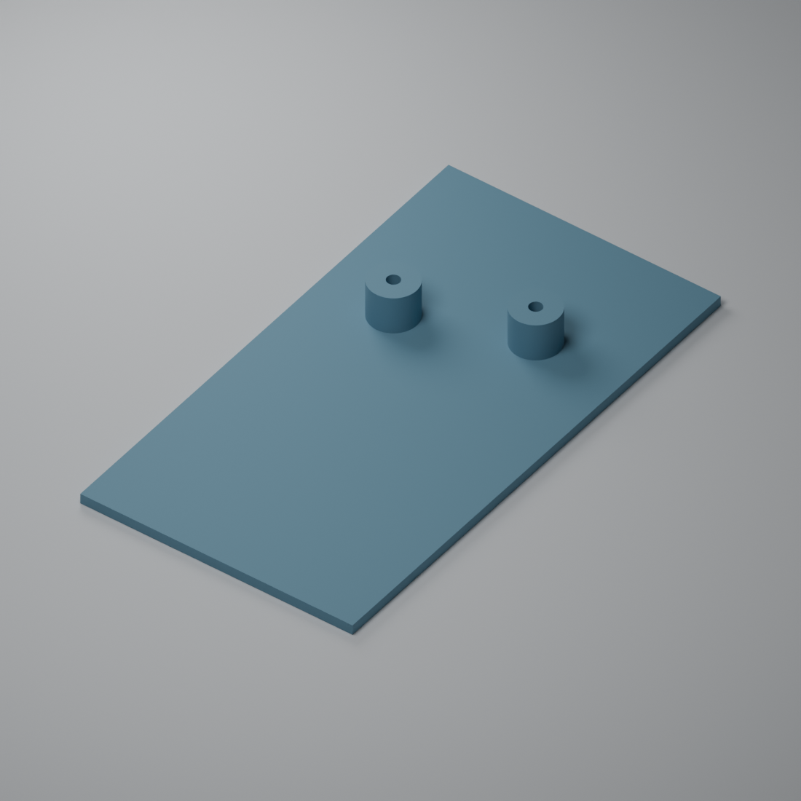

# Replacement optical lid R1

> **Theoretical optical prototype — not a validated measuring head.**
> Development is on hold pending optical redesign/validation and calibration.
> The geometry is informed by manufacturer guidance, but narrow tubes can
> block oblique and diffuse light. A successful print does not establish
> accurate irradiance. Validate this lid with the final sensors, mounting
> heights and any diffuser/filter/window before using measurements.

This prototype combines a rectangular lid and two integral straight optical
tubes into one printable solid. It is intended to **replace the standard
1 mm aluminium top panel** of the purchased **TEKO COFFER-A/6.5** enclosure,
not to be stacked on top of that panel. See the
[printable-parts index](../README.md) and the
[manufacturer's product page](https://www.teko.it/en/products/family/TC/series/coffer-a).
It implements the compact option in the
[directional-head variants](../../README.md#directional-optical-heads-prototype).
The positions below belong to the measured prototype layout; verify alignment
with the actual chip apertures and enclosure before printing or mounting.

The UV and/or visible/NIR modules may need spacers or raised mounting to
reach the intended window plane. Lid fixing holes, internal board supports
and LED/USB openings are left to the builder; ESP32 USB-C placement depends
on the fitted board. Any height/gap or aperture change needs optical validation.

## Files

- [Printable STL](uvir-optical-lid-r1.stl): unitless STL coordinates represent
  **millimetres**; one connected closed solid with two through-bores.
- [Editable OpenSCAD source](uvir-optical-lid-r1.scad): parameters and tube-center
  positions for regenerating or adjusting the model.
- [STL geometry verification](stl-verification.json): dimensions, manifold and
  connectivity checks, bore checks and SHA-256 of the included STL.

## Dimensions and orientation

All dimensions are in millimetres. View the lid **from the tube side in portrait
orientation**, with the 65.4 mm edge horizontal and the 120.3 mm edge vertical.
Top/left/right distances refer to the outer edges of that rectangle and locate
the **centers** of the bores.

| Dimension | Value |
|---|---:|
| Lid width | 65.4 |
| Lid height in the top view | 120.3 |
| Lid thickness | 2.4 |
| Tube projection above the lid | 9 |
| Clear bore diameter, both tubes | 3 |
| Radial tube wall thickness | 4 |
| Tube outside diameter | 11 |
| Total printed-part height | 11.4 |

| Bore | From left | From right | From top |
|---|---:|---:|---:|
| 1 | 17.6 | 47.8 | 41.9 |
| 2 | 44.5 | 20.9 | 32 |

The source uses a bottom-left XY origin, with +Y toward the top edge, so its
center coordinates are `(17.6, 78.4)` and `(44.5, 88.3)`. This is the same
placement as the top-edge measurements above. Both bores are open through the
entire lid and tubes. The plate has a flat underside.

This version has no enclosure screw holes, locating tabs or snap features.
Verify its edge clearance and retention against the purchased housing before
using it as the replacement panel; adapt the source if fastening features are
needed. Fit the separate [visible/NIR LED shield](../uvir-visible-nir-shield-r1/README.md)
inside the enclosure without blocking either intended optical input.

## Optical height and entrance angle

The assumed gap between each chip's **top optical-window plane** and the lid's
underside is **1 mm**. It is air space in the assembly, not printed material:

`optical height = gap + lid thickness + projection = 1 + 2.4 + 9 = 12.4 mm`

The printed-part height is only `2.4 + 9 = 11.4 mm`. A different real gap changes
the optical height and entrance angle. Measure it at the optical window rather
than the PCB or the bottom of the sensor's package opening, and block lateral
stray-light paths across the gap.

For a centered point detector, the 3 mm bore and 12.4 mm optical height give an
ideal full entrance cone of about **13.8 degrees** (half-angle about 6.9 degrees).
The original 6 mm / 25 mm option gives about 13.7 degrees. The design objective
is the entrance angle; the exact tube size can vary. These are geometric estimates:
finite detector positions, chip openings, centering, reflections and any diffuser
affect the actual channel response. Follow the [diffuser and validation notes](../../README.md#diffuser-and-final-optical-validation)
and [final-assembly calibration plan](../../calibration/README.md).

## Printing and validation status

Orient the flat lid underside on the build plate, with both cylinders pointing
up. At a 0.2 mm layer height, the nominal lid is 12 layers and the additional
tube projection is 45 layers, totaling 57 layers / 11.4 mm. Check the slicer's
millimetre scale and measure the printed clear bores, center spacing and heights.

The STL was checked as a single consistently oriented closed manifold, with
two open bores, no zero-area triangles, the specified dimensions and the same
rectangular footprint as the original plate. The 192 segments per circle define
nominal geometry, not printer tolerances. The 4 mm walls provide mechanical
thickness; check the chosen material's UV/VIS/NIR opacity and internal reflections.

Physical enclosure/PCB fit, material behavior and optical response have not yet
been validated. This lid does not add or validate an optical diffuser, protective
window or absolute irradiance calibration.
