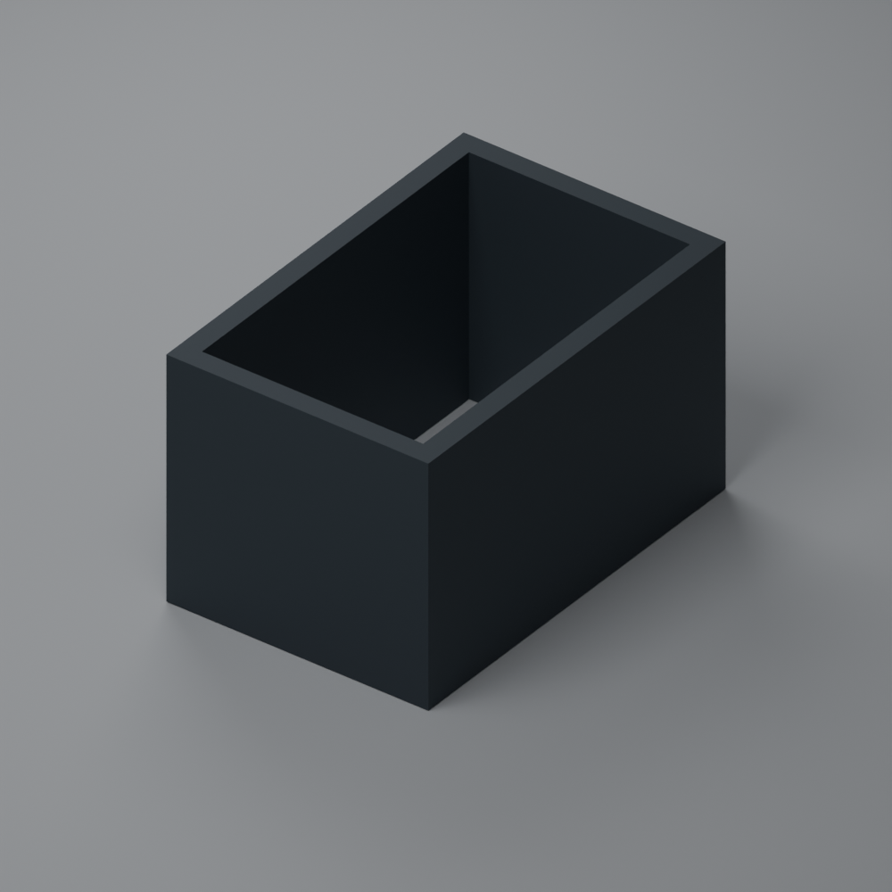

# Visible/NIR light shield R1

This internal rectangular shield surrounds the **AS7343 visible/NIR optical
path** and blocks stray light from the instrument's indicator LEDs, including
LEDs on other breakout boards. Its purpose is to keep internally generated
light out of the measurement. It belongs inside the
[TEKO COFFER-A/6.5 enclosure](../README.md), below the
[replacement optical lid](../uvir-optical-lid-r1/README.md).

## Files

- [Printable STL](uvir-visible-nir-shield-r1.stl): one connected solid; coordinates
  represent **millimetres**. Import at 1:1 scale in the printer's slicer.
- [Editable OpenSCAD source](uvir-visible-nir-shield-r1.scad): internal dimensions,
  height and outward wall thickness can be adjusted.
- [Geometry verification](stl-verification.json): dimensions, connectivity,
  orientation, volume and SHA-256 of the supplied STL.

## Dimensions

| Dimension | Value |
|---|---:|
| Clear internal width | 13 mm |
| Clear internal length | 21 mm |
| Height | 14 mm |
| Wall thickness, extending outward | 1.2 mm |
| Outside width | 15.4 mm |
| Outside length | 23.4 mm |

There are **four continuous walls, no roof and no floor**. The internal opening
passes through the full height. The 1.2 mm walls are added outside the specified
13 x 21 mm opening; they do not reduce it. No fit clearance, clip, mounting hole
or interference fit has been added to the nominal geometry.

## Printing and mounting

Place either flat rectangular rim on the build plate, with the walls upright.
At 0.2 mm layer height the nominal height is 70 layers. A 1.2 mm wall corresponds
to three nominal 0.4 mm extrusion lines, but check the actual slicer line width
and generated walls rather than assuming nozzle diameter fixes extrusion width.

Use an opaque, low-reflectance material that also blocks the relevant NIR light.
Dry-fit around the intended optical path without pressing on the sensor or
touching exposed contacts. Keep indicator LEDs outside the enclosed optical
path. Close unintended gaps at the board and lid while keeping the sensor
aperture, intended diffuser and incoming-light path clear. The shield's 14 mm
height is a mechanical dimension, not the directional tube's optical height.

This model provides the four-wall barrier only. The attachment and clearance
must be checked on the actual board and enclosure. Mesh validation does not
establish physical fit or optical opacity. Calibrate after final mounting with
the normal operating LED configuration.

## Why this shield is intended for the AS7343

The fitted prototype's indicator LEDs are:

- a green LED on the UV breakout;
- red LEDs on the ESP32 and RTC boards;
- the red and green elements of the RGB status LED;
- a separate blue LED indicating queued data awaiting synchronization.

These are visible-light indicators, not UV sources. The AS7331 UV detector
itself does not emit UV. The green UV-board LED can illuminate the AS7343, so
keep it outside the visible/NIR shield's optical path. It does not require a
second copy of this shield around the UV chip. The AS7331's interference filters
also reject visible and NIR light, as described by
[ams OSRAM](https://ams-osram.com/news/press-releases/AS7331_CMOSsensor).

No dedicated UV light shield is specified for this LED configuration. Filter
rejection is not an absolute zero-response guarantee: compare final covered-input
readings with the fitted LEDs off and on before calibration. Keep the UV input
unobstructed; the UV tube in the lid still serves its directional purpose.
