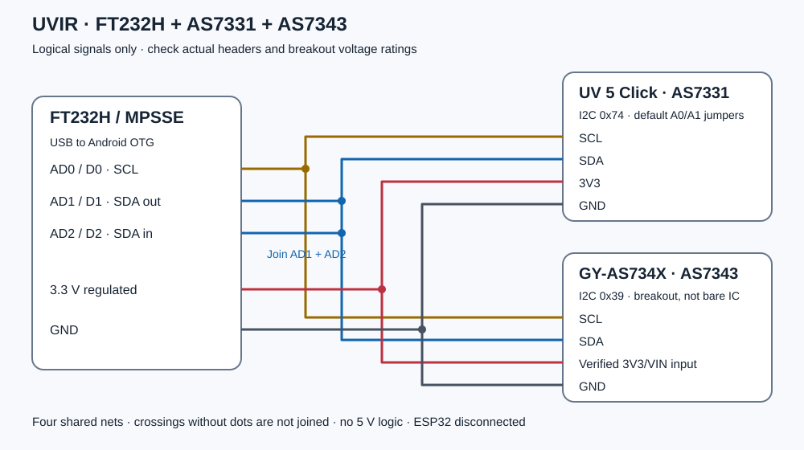

# Uvir hardware

> **Development is suspended at optical calibration.** The assembled prototype
> reads both modules and works with the Android app, but reliable absolute
> irradiance has not been validated. See [project status](../../docs/PROJECT_STATUS.md).

## Components and functional wiring

- FT232H MPSSE USB-to-I²C board, normally VID/PID `0403:6014`.
- MIKROE UV 5 Click / AS7331, address `0x74`.
- GY-AS734X breakout containing AS7343, address `0x39`.
- USB data connection; on a USB-C phone use an appropriate USB-C male to
  USB-A female OTG adapter for a head fitted with a USB-A male connector.

| Common net | FT232H | AS7331 breakout | AS7343 breakout |
|---|---|---|---|
| Clock | AD0 / D0 | SCL | SCL |
| Data | **AD1 / D1 joined to AD2 / D2** | SDA | SDA |
| Regulated supply | Verified 3.3 V rail | 3V3 | Breakout input rated for 3.3 V |
| Ground | GND | GND | GND |

This is a signal/net diagram, **not physical header order or a prescription for
individual wires on the perfboard**. The two sensors share one bus. FT232R/FT232RL
UART adapters are not substitutes. Keep another controller off the active bus.
AS7331 SYN/RDY and Click-ID pins are not used by this design.

Check the actual adapter regulator, supply/current rating, pull-ups and breakout
level shifting. The bare AS7343 is a 1.8 V device: the documented 3.3 V hookup
requires a suitable breakout, not a directly wired bare chip. Do not apply 5 V
to either sensor's I²C logic. Keep the wiring short. Uvir initially uses 100 kHz.
See [electrical checks and first connection](../../docs/usb/WIRING.md).

## Carrier and removable modules

The current prototype uses a hand-built **perfboard carrier**, approximately
43.5 × 85.8 × 1.5 mm. The optical breakout boards are not soldered directly to
that carrier. Raised plug-in sockets/header supports are attached to the carrier,
and the modules can be unplugged, repositioned in a revised assembly, or reused
in another project. Match the actual pin layout, polarity and mounting height;
no unmeasured socket model or universal spacer height is specified.

The electrical connection plan is complete without reproducing the owner's
individual wire-routing arrangement. Mounting and optical centres for the supplied
case are documented in the [mechanical reference](../printable/uvir-custom-case/README.md).
Changing sockets, stack height or module placement can require a revised lid.

## Head and host responsibilities

The head supplies readings over USB. Android owns processing, calibration
settings, time, sessions and the archive. FT232H accepts binary MPSSE/I²C
transactions; the optical modules expose conversion and status registers.

[Standalone USB reading](../../docs/usb/STANDALONE.md) provides the register
send/receive reference and a Python raw-count reader for another host. That
independent Python reader still requires physical validation; it does not inherit
the phone's calibration or processing merely by reading the same components.
